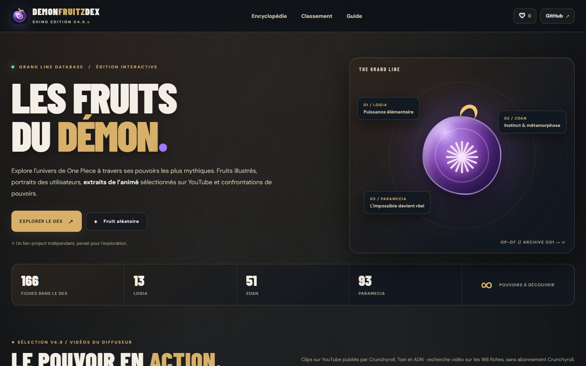
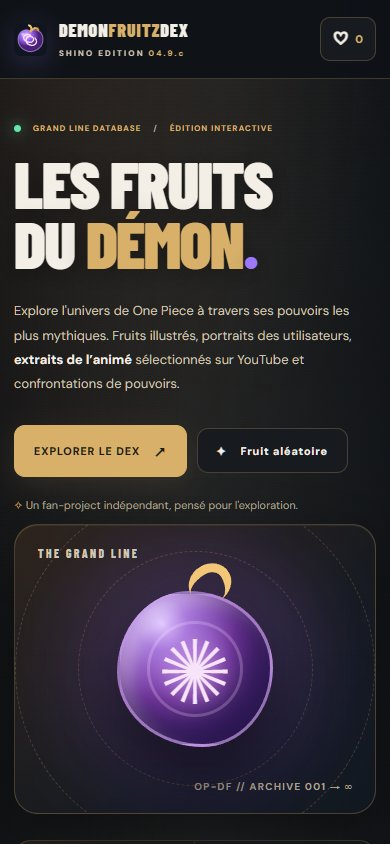

# V4.9.c — Parchment Archive Theme

Date : 11 octobre 2026. Branche : `feature/v4.9c-parchment-archive`.
Base auditée : `main`, commit `cb64b52eb257b57d83f17e8ccb9a52f6b47d7ecd`.

## Design et périmètre

L'interface garde ses proportions, ses polices DM Sans / Barlow Condensed et son identité sombre.
Une texture de papier sous un voile charbon, une chaleur brune localisée, des textes ivoire et des
bordures or ancien unifient le hero, les filtres, les cartes, les fiches, le comparateur et les outils.
Les portraits, illustrations et miniatures gardent leurs dimensions et leurs traitements existants.
Les couleurs des familles, les avertissements et les états des médias restent distincts.

L'audit a porté sur les vrais sélecteurs : `.site-header`, `.hero`, `.hero-stage`, `.filter-panel`,
`.fruit-card`, `.card-visual`, `.detail-dialog`, `.detail-grid-cinema`, `.detail-character-hero`,
`.official-player`, `.compare-dialog` et `.compare-dock`. Les anciens fonds étaient charbon/bleu,
avec halos violet/bleu fixes. Les breakpoints existants (1500, 1170, 1100, 950, 850, 660, 600 et
540 px) sont conservés ; les petits ajustements tactiles utilisent le breakpoint 540 px.

- `styles.css` : surfaces, textes secondaires, bordures, hover discret, focus et confort mobile.
- `assets/css/archive-theme.css` : palette et fond partagés ; styles des outils limités à leurs classes.
- Les trois pages HTML : liens CSS relatifs et couleur du navigateur ; version visible du Dex actualisée.
- CI : mêmes neuf validations, déclenchement étendu aux assets du thème et à MEDIA CHECK,
  artifact `DemonFruitzDex-V49c-preview` incluant ce rapport et les captures.
- `app.js`, `data/**`, l'icône et les anciennes vidéos restent identiques à la base Git.
  166 fiches, 50 associations YouTube / 36 fruits, aucun lien d'épisode complet.

## Texture et provenance

Asset livré : [parchment-bg.webp](../assets/bg/parchment-bg.webp).
1536 × 1024, WebP qualité 72, **137 364 octets (134,1 Kio)**.
SHA-256 : `3eaae8e465ecc6ea54c74dce6e962f24ae093b738bdecb797892aff30c3ba025`.

L'affiche fournie par le propriétaire sert de référence de papier. La texture a été reconstruite
avec l'outil intégré **imagegen**, puis encodée en WebP avec Pillow. Ce n'est pas une extraction
pixel pour pixel d'une zone certifiée de l'affiche. Aucun fruit, texte, dessin de personnage,
bande ou fichier de l'affiche n'est ajouté au dépôt. La permission de republier les dessins
de l'affiche n'est pas présumée. Les visuels externes déjà présents restent référencés comme avant.

Le papier se répète à 768 × 512 px sur desktop et 576 × 384 px sur petit écran, sous des gradients
de lisibilité et une vignette. Le fond défile normalement, sans couche fixe ni nouveau contexte
d'empilement. La couleur charbon et les gradients restent utilisables si l'image échoue.

Prompt exact — outil imagegen intégré

Use case: precise-object-edit. Asset type: a clean aged parchment background texture for a premium dark encyclopedia website. Input image 1 is the supplied Devil Fruit poster, used solely as the aged PAPER reference/edit target. Primary request: remove every fruit drawing, character, word, label, typography, heading, stripe and graphic from the image, and reconstruct ONLY uninterrupted clean parchment. Preserve the authentic finely fibrous, softly mottled old paper character and muted tan / warm ivory / antique brown palette of the bare paper. Flat evenly lit top-down material scan, landscape 1536x1024, edge-to-edge natural paper surface, uniform tone at opposite edges suitable for unobtrusive tiling. Subtle small grain and soft organic tonal variation, no strong creases or high-contrast stains. No perspective, no objects, no writing, no ink, no decorative marks, no map, no borders, no burned edges, no vignette, no colored remnants, no watermark. This will sit under a dark charcoal overlay at low intensity; clarity and clean nonrepeating organic texture are essential.

## Validation locale et navigateur

Chrome installé, piloté par Playwright en mode headless le 11 octobre 2026, sur un serveur local
reproduisant le préfixe GitHub Pages `/DemonFruitzDex/`. Le Chromium fourni ne démarrait pas
(configuration côte-à-côte Windows) ; les contrôles ci-dessous ont réellement été exécutés dans Chrome.

| Format | Colonnes de cartes | Page / fiches / comparateur | CLIP CHECK / MEDIA CHECK |
|---|---:|---|---|
| 1920 × 1080 | 5 | PASS | PASS |
| 1440 × 900 | 4 | PASS | PASS |
| 768 × 1024 | 2 | PASS | PASS |
| 390 × 844 | 1 | PASS | PASS |
| 360 × 800 | 1 | PASS | PASS |

Avant et après : recherche, filtre Logia, favoris, comparateur à deux fruits, lien profond Nika
avec clip précis, navigation suivant/précédent et fermeture des modals. Après : insertion de
l'iframe YouTube à la demande, arrêt du lecteur lors du changement de fiche, défilement des
fiches longues, aperçu CLIP CHECK, chargement des 166 fiches dans MEDIA CHECK, interactions
tactiles sur mobile, modes de mouvement normal et réduit. Aucun débordement horizontal,
erreur JavaScript ou réponse HTTP en échec pour une ressource locale aux cinq formats.

Contrôles supplémentaires desktop/mobile : proposition vidéo conservée localement,
verdict « mauvais pouvoir » repris dans le Dex avec lecture suspendue, et texture volontairement
bloquée laissant la page lisible et les 24 premières cartes utilisables. Aucun résultat personnel
de ces sessions de test n'est publié dans le catalogue.

Les neuf scripts de la CI passent localement :
`validate_clips.py`, `check_v45.py`, `check_v46.py`, `check_v48.py`, `check_v49.py`,
`check_v49a.py`, `check_v49b.py`, `check_v49b2.py`, `check_v49b3.py`.
`node --check app.js`, `node --check data/clips.js` et `git diff --check` passent.
Le JavaScript inline de CLIP CHECK est contrôlé par le script V4.9.b3.
Les scripts inline des outils restent identiques à la base.
Le résultat CI du commit proposé est disponible dans les checks de la PR ; ce rapport décrit
les validations locales et navigateur, pas une autorisation de publication.

## Accessibilité et coût

| Paire de couleurs vérifiée | Contraste |
|---|---:|
| Ivoire / surface brune la plus claire | 13,56:1 |
| Texte secondaire / surface brune | 9,29:1 |
| Texte discret / surface brune | 6,26:1 |
| Or / contrôle sélectionné | 6,75:1 |
| Texte du bouton principal / or | 8,61:1 |

Ces paires dépassent 4,5:1 ; elles ne constituent pas un audit WCAG complet des images ou états tiers.
Focus or visible, recherche signalée sur toute sa bordure, contrôles principaux de 44 px sur petit
écran, champs mobiles à 16 px et respect de `prefers-reduced-motion`, y compris sur le hover.
Le contraste des couleurs de familles n'a pas été uniformisé.

Un WebP local de 134,1 Kio et une petite feuille CSS partagée ; aucun framework, dépendance
d'exécution ou pipeline de build ajouté. Suppression des halos fixes floutés et du blur sur chaque
carte ; le blur reste limité à la navigation desktop, au dock et aux fonds des modals.
Les bordures décoratives restent volontairement discrètes. Aucun score Lighthouse n'est revendiqué.

## Captures revues

Les captures d'accueil et de fiche sont disponibles avant/après à 1440 et 390 px. Les cinq
formats ont également été capturés et inspectés après modification ; les captures de référence
desktop/mobile ci-dessous sont conservées dans le dépôt.

| Vue | Avant | Après |
|---|---|---|
| Accueil desktop | [1440](screenshots/v49c/before-1440-home.jpg) | [1440](screenshots/v49c/after-1440-home.jpg) |
| Accueil mobile | [390](screenshots/v49c/before-390-home.jpg) | [390](screenshots/v49c/after-390-home.jpg) |
| Fiche desktop | [1440](screenshots/v49c/before-1440-detail.jpg) | [1440](screenshots/v49c/after-1440-detail.jpg) |
| Fiche mobile | [390](screenshots/v49c/before-390-detail.jpg) | [390](screenshots/v49c/after-390-detail.jpg) |

Autres vues après : [catalogue desktop](screenshots/v49c/after-1440-catalogue.jpg),
[filtres mobile](screenshots/v49c/after-390-catalogue.jpg),
[bas de fiche mobile](screenshots/v49c/after-390-detail-media.jpg),
[comparateur mobile](screenshots/v49c/after-390-compare.jpg),
[CLIP CHECK](screenshots/v49c/after-390-clip-check.jpg),
[MEDIA CHECK](screenshots/v49c/after-390-media-check.jpg).

## Limites et décision

Les miniatures YouTube chargent dans les captures. Certains portraits et illustrations wiki
distants déclenchent déjà les secours sur la base avant modification, et les mêmes secours
restent visibles après. Aucun URL ni média n'a été substitué pour masquer ce constat.
Le chargement d'une iframe ne prouve ni lecture effective, ni disponibilité en France,
ni accès sans compte ; ces points restent à vérifier avec CLIP CHECK par le propriétaire.
MEDIA CHECK a été vérifié pour son interface et ses données, sans certifier toutes les images
distantes ni lancer une revue complète de leurs droits.

Aucune régression locale du thème détectée. Prêt pour revue de la PR après CI verte.
Fusion et publication restent soumises à l'approbation explicite du propriétaire.
